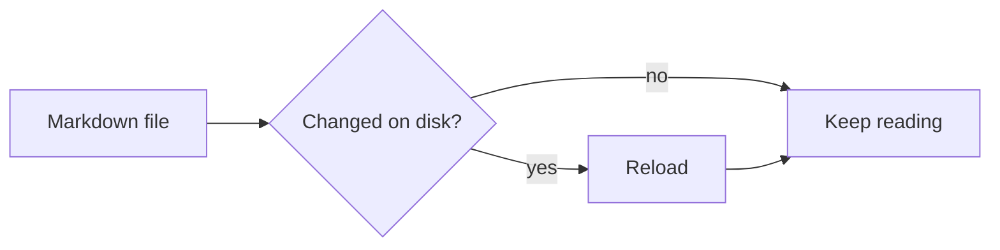
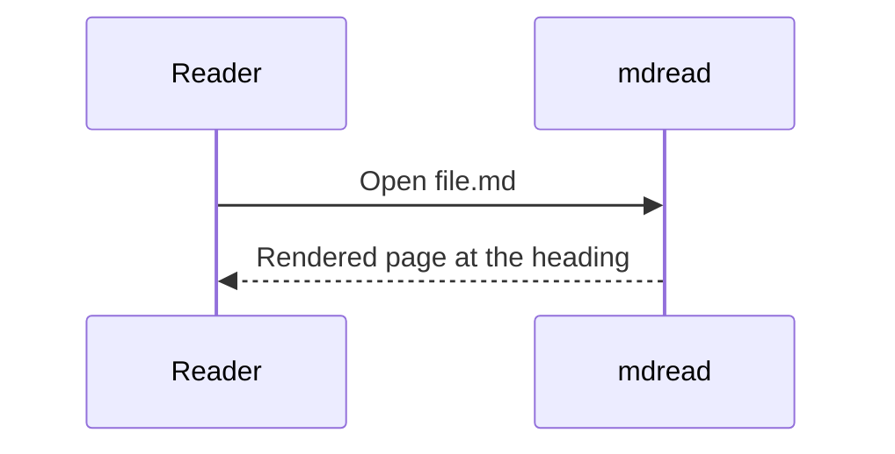

# mdread showcase

A quick tour of everything the viewer renders. This paragraph has **bold**, *italic*, ***bold italic***, ~~strikethrough~~, `inline code`, a [link to the Rust site](https://www.rust-lang.org "Rust"), an autolink <https://github.com>, a ~subscript~ and a ^superscript^, and a footnote reference.[^1] Smart punctuation turns "quotes" and -- dashes --- into the proper glyphs...

Here is a second paragraph to check paragraph spacing and line height on a wide column. The reading column is capped at a comfortable measure so that lines stay readable on a very large display, while the sidebars put the remaining width to use. Press `w` to let the text span the whole window, or `[` and `]` to adjust the column width in steps.

## Headings

### Level three heading

#### Level four heading

##### Level five heading

###### Level six heading

## Lists

- Unordered item one
- Unordered item two with `code` and a [relative link](./second.md)
  - Nested item
  - Another nested item
    - Third level
- Item three

1. First ordered item
2. Second ordered item
3. Third ordered item
   1. Nested ordered
   2. Nested ordered two
10. Tenth item (start number preserved)

- [x] Completed task
- [ ] Pending task
- [ ] Another pending task with a longer description that wraps onto a second line when the column is narrow enough to force it

A loose list:

- Paragraph one of the first item.

  Paragraph two of the first item.

- Second item.

## Code

```rust
use std::collections::HashMap;

/// Count words in a string.
pub fn word_counts(text: &str) -> HashMap<&str, usize> {
    let mut counts = HashMap::new();
    for word in text.split_whitespace() {
        *counts.entry(word).or_insert(0) += 1;
    }
    counts
}

fn main() {
    let counts = word_counts("the quick brown fox jumps over the lazy dog the end");
    println!("{:?}", counts.get("the")); // Some(3)
}
```

```python
import asyncio
from dataclasses import dataclass

@dataclass
class Job:
    name: str
    retries: int = 3

async def run(job: Job) -> None:
    for attempt in range(job.retries):
        try:
            await asyncio.sleep(0.1)
            print(f"{job.name}: ok on attempt {attempt + 1}")
            return
        except Exception as exc:  # noqa: BLE001
            print(f"{job.name}: {exc!r}")
```

```bash
#!/usr/bin/env bash
set -euo pipefail
for f in *.md; do
  mdread "$f" &
done
wait
```

```json
{ "name": "mdread", "fast": true, "deps": ["egui", "pulldown-cmark", "syntect"], "version": 0.1 }
```

A very long line to exercise horizontal scrolling inside code blocks:

```text
Lorem ipsum dolor sit amet, consectetur adipiscing elit, sed do eiusmod tempor incididunt ut labore et dolore magna aliqua. Ut enim ad minim veniam, quis nostrud exercitation ullamco laboris nisi ut aliquip ex ea commodo consequat.
```

    An indented code block
    with two lines.

## Diagrams





## Block quotes and alerts

> A plain block quote. It can span multiple lines and contain **formatting**, `code`, and [links](#headings).
>
> > Nested quote inside the first one.

> [!NOTE]
> Useful information that users should know, even when skimming content.

> [!TIP]
> Helpful advice for doing things better or more easily.

> [!IMPORTANT]
> Key information users need to know to achieve their goal.

> [!WARNING]
> Urgent info that needs immediate user attention to avoid problems.

> [!CAUTION]
> Advises about risks or negative outcomes of certain actions.

## Tables

| Feature | Status | Notes |
|:--------|:------:|------:|
| GPU rendering | ✅ | egui + OpenGL via glow |
| Syntax highlighting | ✅ | syntect, background thread |
| Live reload | ✅ | watches the parent directory |
| Images | ✅ | PNG, JPEG, GIF, WebP, SVG |
| Math | partial | rendered as monospace |

| Key | Action |
|-----|--------|
| `j` / `k` | Scroll one line down / up |
| `Space` / `Shift+Space` | Page down / up |
| `g` / `G` | Jump to top / bottom |
| `/` | Search |
| `o` | Toggle the outline sidebar, which tracks the current section as you scroll through a long document |

## Images


Inline badges:   Text continues after the badges.


## Math

Inline math like $E = mc^2$ renders in a tinted monospace face.

$$
\int_0^\infty e^{-x^2} \, dx = \frac{\sqrt{\pi}}{2}
$$

## Definition list

Term one
: Definition of the first term.

Term two
: First definition of the second term.
: Second definition of the second term.

## HTML

<p align="center">
  
</p>

Some inline <b>HTML bold</b> and a line<br>break via `<br>`. A <kbd>Ctrl</kbd>+<kbd>O</kbd> keyboard hint.

<details>
<summary>Click to expand (rendered as text)</summary>
Hidden details content.
</details>

## Horizontal rule

Text above the rule.

---

Text below the rule.

## Long section for scrolling

Paragraph 1. The quick brown fox jumps over the lazy dog. Pack my box with five dozen liquor jugs. How vexingly quick daft zebras jump! The five boxing wizards jump quickly. Sphinx of black quartz, judge my vow.

Paragraph 2. The quick brown fox jumps over the lazy dog. Pack my box with five dozen liquor jugs. How vexingly quick daft zebras jump! The five boxing wizards jump quickly. Sphinx of black quartz, judge my vow.

Paragraph 3. The quick brown fox jumps over the lazy dog. Pack my box with five dozen liquor jugs. How vexingly quick daft zebras jump! The five boxing wizards jump quickly. Sphinx of black quartz, judge my vow.

Paragraph 4. The quick brown fox jumps over the lazy dog. Pack my box with five dozen liquor jugs. How vexingly quick daft zebras jump! The five boxing wizards jump quickly. Sphinx of black quartz, judge my vow.

Paragraph 5. The quick brown fox jumps over the lazy dog. Pack my box with five dozen liquor jugs. How vexingly quick daft zebras jump! The five boxing wizards jump quickly. Sphinx of black quartz, judge my vow.

### Subsection A

Content of subsection A. Jump here from the outline.

### Subsection B

Content of subsection B. The outline highlights whichever section is at the top of the viewport.

## Footnotes

Another footnote reference here.[^note]

[^1]: This is the first footnote, with *formatting*.
[^note]: A named footnote that spans
    two lines of source.
